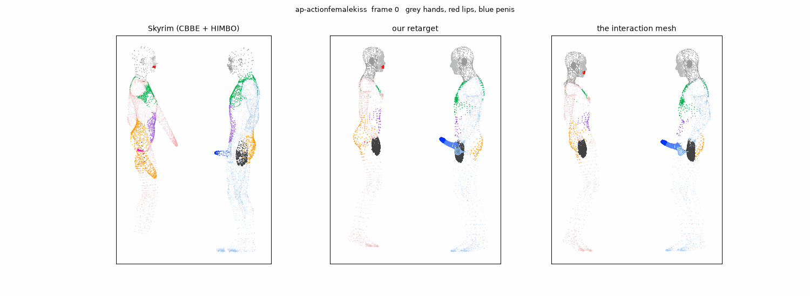

# cyberpunk_animport

Port a Skyrim animation pack (OStim or SexLab) to Cyberpunk 2077 with one command. You get a zip you install like
any mod, and NightCityNet plays its scenes: on NPCs, on the big and fat bodies,
and on V.




## 1. Install once

1. **Python 3.12**, from python.org, then:
   ```
   pip install numpy scipy
   ```
   With an NVIDIA card, also `pip install cupy-cuda12x`: the pair fit runs much faster.
2. **WolvenKit console** 8.20.0 or later, and the **.NET 10 runtime**: from
   [WolvenKit releases](https://github.com/WolvenKit/WolvenKit/releases), take `WolvenKit.Console-<version>.zip`.
3. **hkxc** ([Nexus 166424](https://www.nexusmods.com/skyrimspecialedition/mods/166424)), unpacked to
   `third_party\hkxc\`.
4. **blender-hkx** ([Nexus 118525](https://www.nexusmods.com/skyrimspecialedition/mods/118525?tab=files)), unpacked
   to `third_party\blender-hkx\`.
5. **7-Zip**, only to port a `.7z` download.

Then let the tool find everything:

```
python tools\port.py setup
python tools\port.py check
```

`check` lists anything still missing and where to get it. The skeletons ship with this repo.

## 2. Port a pack

```
python tools\port.py run --input "<the pack: a folder, .zip or .7z>" --pack <shortname> --name "<Shown Name>"
```

For example:

```
python tools\port.py run --input "D:\downloads\Anubs Animation Pack.7z" --pack anub --name "Anub's Animations"
```

- `--input`: the mod as installed (a folder) or as downloaded (`.zip` / `.7z`). OStim or SexLab is detected on its
  own; `--format ostimng|sexlab` if it is not.
- `--pack`: a short name, letters, digits and `_`.
- `--name`, `--link`, `--version`: what NightCityNet's panel shows for the pack.

A few scenes take minutes, a big pack hours (Anub's 1546 clips: about 25 minutes). If it stops, run the same
command again: it carries on where it stopped. It ends with:

```
done: dist\<pack>-<version>.zip
```

## 3. Make the touches right (pairs)

The run in step 2 fits each actor on their own. Cyberpunk's bodies are shaped differently from Skyrim's, so in a
pair, hands can float off the partner, lips can miss and the groin contact can drift. This step fixes that, and it
is the second GIF above. It needs Skyrim's CBBE and HIMBO bodies installed (set `skyrim_mods` in
`build.local.json` to your Skyrim mods folder), and is much faster with CuPy.

From `tools\retarget`, after step 2:

```
python pair_reach.py --pack <shortname>
$env:MESH='1'; $env:SAVE='1'; $env:HANDFIT='1'; $env:MESH_SKIN='1'; python pair_batch.py <shortname> 4
```

Then run step 2's command again: it rebuilds only the clips this step changed, and makes a new zip (give it a new
`--version`).

## 4. Install and check

1. Install the zip in your mod manager as its own mod, like any other.
2. Start the game. NightCityNet lists the pack on its panel under integrations, and its scenes play with the
   mod's own.
3. Every clip is also a pose in Appearance Menu Mod's list.

Check a few scenes in game before you publish the zip.

## Editing the scenes

The scene files are written once, under `<packs>\<pack>\...\scenes\integrations\<pack>\`, and are yours to edit:
a rerun keeps them. Delete that folder to rebuild them from the pack.

- **OStim** packs: postures, acts, furniture, moves between scenes and names come from the pack.
- **SexLab** packs: each stage is a scene that moves on to the next. Postures, acts and furniture are guessed from
  the tags, for two actors where exactly one has a penis; other scenes play as idles. Furniture props are not
  carried over.

## What is in the zip

- `archive\pc\mod\<pack>.archive`: the animations, for every body and V.
- `archive\pc\mod\<pack>_ncn.archive`: the workspots that play them.
- `archive\pc\mod\<pack>_amm.archive` and an AMM list: every clip as a pose.
- `...\nightcitynet\data\scenes\integrations\<pack>\`: the scene files.
- `licenses\<pack>\`: the source pack's own licence and credits.

## More

- How each step works, and the developer notes: [docs/pipeline.md](docs/pipeline.md).
- Licence: the code is GPL-3.0 (`LICENSE`). The skeletons, templates and GIFs are other people's work under their
  own terms (`NOTICE.md`). A pack you port stays under its source pack's terms.
