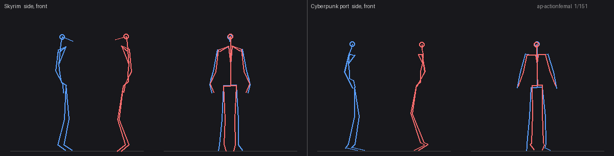
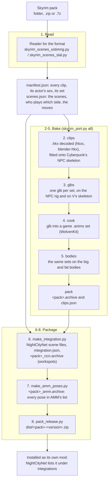

# cyberpunk_animport

Turns a Skyrim animation pack (OStim or SexLab) into a NightCityNet animation pack for Cyberpunk 2077: the clips
fitted onto Cyberpunk's bodies and V, the scenes the mod plays, and a zip you install like any mod.

OpenSex's standing kiss, Skyrim on the left, the Cyberpunk port on the right:



The same kiss on the bodies: Skyrim's (CBBE + HIMBO), ours as retargeted, and ours after the interaction mesh holds
the touches (grey hands, red lips):


## What you need

| | Where to get it |
|---|---|
| Cyberpunk 2077 | your Steam / GOG / Epic install |
| Python 3.12 with `numpy` and `scipy` (`cupy` too on an NVIDIA card: the body fit is much faster) | python.org, then `pip install numpy scipy` |
| WolvenKit console, 8.20.0 or later, and the .NET 10 runtime | [WolvenKit releases](https://github.com/WolvenKit/WolvenKit/releases): `WolvenKit.Console-<version>.zip` |
| hkxc | [Nexus 166424](https://www.nexusmods.com/skyrimspecialedition/mods/166424), unpacked to `third_party/hkxc/` |
| blender-hkx | [Nexus 118525](https://www.nexusmods.com/skyrimspecialedition/mods/118525?tab=files), unpacked to `third_party/blender-hkx/` |
| 7-Zip, only for a `.7z` input | 7-zip.org |

The Skyrim skeletons (from [XPMSE](https://www.nexusmods.com/skyrimspecialedition/mods/1988)) and the Cyberpunk
skeletons ship in `skeletons/`.

## Port a pack

```powershell
python tools\port.py setup     # finds the game and the tools, writes them to build.local.json
python tools\port.py check     # what is still missing, and where to get it

python tools\port.py run --input "D:\mods\Some OStim Pack" --pack somepack --name "Some OStim Pack"
python tools\port.py run --input "D:\downloads\SomeSexLabPack.7z" --pack slpack --link https://www.nexusmods.com/...
```

- `--input`: the mod as installed (a folder) or as downloaded (`.zip` / `.7z`).
- `--pack`: a short folder name, letters, digits and `_`.
- `--format ostimng|sexlab`: only when the format is not recognised by itself.
- `--name`, `--link`, `--version` (default 0.1.0): what the mod's panel shows for the pack.

A run takes minutes for a few scenes and hours for a big pack. Stopped part way, run the same command again: it
picks up where it stopped. It ends with:

```
done: dist\<pack>-<version>.zip -- install it like any mod; NightCityNet lists it under integrations
```

### What is in the zip

- `archive/pc/mod/<pack>.archive`: the animations, on the NPC body, big and fat bodies and V.
- `archive/pc/mod/<pack>_ncn.archive`: the workspots that play them.
- `archive/pc/mod/<pack>_amm.archive` and an AMM list: every clip as an AMM pose.
- `.../nightcitynet/data/scenes/integrations/<pack>/`: `integration.json`, `clips.json` and one file per scene.
- `licenses/<pack>/`: the pack's own `LICENSE` and `CREDITS.md`, if it has them.

### After the first run

The scene files are yours to edit (under `<packs>/<pack>/.../scenes/integrations/<pack>/`); a rerun keeps them.
To rebuild them from the pack, delete that folder and run again.

What the port reads from each format:

- **OStim**: postures, acts, furniture, moves between scenes and names come from the pack's scene files.
- **SexLab**: each stage is a scene that moves to the next. Postures, acts and furniture are guessed from the
  stage's tags, for two actors where exactly one has a penis; other scenes are left unrated and play as idles.
  SexLab's furniture props are not carried over.

Check the result in game before you publish it.

## How it works

`port.py run` is one pipeline. Each step writes files the next one reads, so a stopped run picks up where it left
off, and a step whose inputs did not change is skipped.



| Step | Tool | What it does | Writes |
|---|---|---|---|
| 1. Read | `skyrim_scenes_ostimng.py`, `skyrim_scenes_slal.py` | Reads the pack's own scene files: which clip each actor plays, their sex, the stages and the moves between them. SexLab tags become postures, acts and furniture, and the man is put first, as the game casts a pair | `manifest.json`, `scenes.json`, `source-map.json` in the run folder |
| 2. clips | `skyrim_tagfile.py`, `skyrim_skeleton.py`, hkxc, blender-hkx, `skyrim_retarget.py` | Decodes each Skyrim `.hkx` against the skeleton of the sex it was made for, once, then copies every bone's movement onto Cyberpunk's NPC skeleton (`man_base`, `woman_base`) by matching bone directions | `decoded/*.npz`, `clips/<set>/<clip>.npz` |
| 3. glbs | `skyrim_port.py`, `retarget_glb.py`, `pair_reach.py` | Puts each set's clips into one glb on the NPC rig, and a second on V's own skeleton (`player_*_skeleton`), so V can play it too. In a pair, an oral giver is slid to the reach the source had | `glb/.../*.anims.glb` |
| 4. cook | `wk_anims` (WolvenKit) | Turns each glb into the game's `.anims` format | `depot/.../*.anims` |
| 5. bodies | `retarget_glb.py`, `wk_anims` | The NPC sets again on the big and fat bodies (`man_big`, `man_fat`, `woman_big`, `woman_fat`) | `depot/.../man_big/...` |
| pack | `skyrim_port.py pack` | Packs every set into one archive and lists which bodies have each clip | `<pack>.archive`, `clips.json` |
| 6. Scenes | `make_integration.py` | Writes one NightCityNet scene file per scene, the pack's `integration.json`, and one workspot per head count that holds all its clips | `scenes/integrations/<pack>/`, `<pack>_ncn.archive` |
| 7. AMM | `make_amm_poses.py` | Every clip as a pose in Appearance Menu Mod's list, with its own workspot and host | `<pack>_amm.archive`, AMM's `.lua` |
| 8. Zip | `pack_release.py` | Zips the pack as built, with the source pack's own licence and credits | `dist/<pack>-<version>.zip` |

The mod's own packs (opensex, ostimng) stop after the pack step: the mod's release builds them.

## Developers

### build.json

`build.json` is shared; `build.local.json` beside it (gitignored) holds this machine's paths and the sources
`port.py run` added.

- `tools`: hkxc, blender-hkx, the Skyrim skeletons, WolvenKit, the game.
- `work`: the shared scratch (rigs, donors, cooked rig JSON).
- `packs`: where packs are written; each source writes `<packs>/<pack>`.
- `sources`: per source its `input`, its own `run` folder, its `pack` and its reader (`inventory`). Two sources
  sharing a run folder or a pack are refused before anything runs.
- `mod`: the nightcitynet checkout, for the mod's own packs' workspots.
- `motionbricks`: generated in-between moves; `false` turns them off.

`python tools/retarget/build_config.py` prints what each source reads and writes.

### Run by hand

```powershell
.\tools\retarget\port_all.ps1                 # every source in build.json
.\tools\retarget\port_all.ps1 -Only ostimng   # one
python tools\retarget\skyrim_port.py <stage> --source <pack>
.\tools\py_test.ps1                           # the tests, no game, seconds
```

The mod's own packs (opensex, ostimng) are released by `tools/opensex/make_release.ps1`, not as integrations.

### Compare a port with its source

```
python tools\retarget\compare_gif.py docs\kiss.gif ap-actionfemalekiss [--source opensex]
```

A GIF of a scene's clips, every actor a stick figure: the Skyrim source on the left, the port on the right, each from
the side and the front. It reads what a port run already wrote, so run the port on the source first.

On the bodies, for a pair (a man and a woman), from `tools\retarget`:

```
$env:GIF = '1'; python skyrim_contact.py ap-actionfemalekiss opensex      Skyrim's bodies posed on the clip
$env:MESH = '1'; python pair_contact.py ap-actionfemalekiss opensex       ours, then the GIF
```

It writes `work\contact\contact_<clip>.gif`: Skyrim's bodies, ours as retargeted, ours after the interaction mesh,
and prints where each hand, the lips and the penis touch the partner in each. It needs the Skyrim body mods in
`skyrim_mods` (CBBE, HIMBO). `stick_preview.py <out.png> <set.glb>:<clip>` draws a few frames of any glb as a still.

### Skeletons

- `skeletons/cyberpunk/`: every body a clip is fitted onto (NPC base, big and fat, V's two), each as `.rig`,
  `.rig.json` and `.glb`, and `animset.anims.json`, the empty set the cook fills. Built by
  `tools/retarget/make_skeletons.py`.
- `skeletons/skyrim/`: `skeleton.hkx`, `femskeleton.hkx`, `skeleton242.hkx` (the 242-track XPMSE one).

### Adding a format

A format needs only a reader. It writes the run folder's `manifest.json` (the clips to bake) and
`source-map.json`, the pack's `scenes.json`, and through `scene_list(pack folder, input)` the scene list every later
stage reads (`tools/retarget/scene_list.py`'s docstring is the format). Register it in `scene_list.readers()` and in
`tools/port.py` (`detect` and the reader command). The readers: `skyrim_scenes.py` (OpenSex),
`skyrim_scenes_ostimng.py` (any OStim pack) and `skyrim_scenes_slal.py` (any SexLab pack).

The output layout is NightCityNet's scene graph (`nightcitynet/docs/design/scene-graph.md` §2.1, integrations
§2.1b). The stages: `tools/retarget/README.md`.

## Licence

The code is GPL-3.0 (`LICENSE`). The game skeletons and templates, the Skyrim skeletons and the GIFs are other
people's work under their own terms: `NOTICE.md` lists each. A pack this tool makes is under its source pack's terms.
