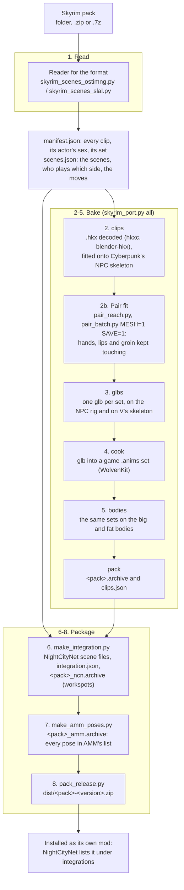

# How the port works

What `tools/port.py run` does, step by step. To port a pack you need none of this: [README](../README.md).


`port.py run` is one pipeline. Each step writes files the next one reads, so a stopped run picks up where it left
off, and a step whose inputs did not change is skipped.



## 1. Read the pack

`skyrim_scenes_ostimng.py` (any OStim pack) or `skyrim_scenes_slal.py` (any SexLab pack) reads the pack's own scene
files. It does not touch an animation yet; it only works out what the pack contains:

- every clip, which actor plays it, and that actor's sex;
- which clips belong together in one animation set (a set is one `.anims` file in the game);
- the scenes: who plays which side, the stages, and the moves from one scene to the next.

OStim names postures, acts and furniture in its scene files, so they are read as written. SexLab does not: it only
has tags such as `vaginal`, `cowgirl` or `chair`, so the reader turns the tags into postures, acts and furniture. It
can do that only for two actors where exactly one has a penis; other scenes stay unrated and play as idles. SexLab
also lists the woman first, and the game casts a pair man first, so the reader puts the man first.

Creature scenes are skipped. The reader writes `manifest.json` (the work list for every later step), `scenes.json`
and `source-map.json` into the run folder, `work/runs/<pack>`.

## 2. clips: decode and fit each animation

A Skyrim animation is a Havok `.hkx` file, which only Windows tools can read. Each clip is read once:

1. `skyrim_tagfile.py` rewrites the clip into the older file layout that hkxc reads.
2. hkxc converts it to the 32-bit format, and blender-hkx decodes it into a plain list of keys per bone.
3. It is decoded against the skeleton of the sex the clip was made for. A clip with more tracks than the skeleton
   has bones (XPMSE's hair, cloak and physics bones) gets a padded skeleton from `skyrim_skeleton.py`, or it would
   decode to nothing.

The decoded clip is cached (`decoded/*.npz`), so a second body playing the same clip does not decode it again.

`skyrim_retarget.py` then fits it onto Cyberpunk's NPC skeleton, `man_base` or `woman_base`. The two skeletons
differ in bone names, in how many bones each chain has and in bone axes, so each Cyberpunk bone is matched to a
Skyrim bone and follows the direction that bone points in. The neck and collarbones copy their bend instead of
their direction, or every clip stood the neck upright and dropped the shoulders. The result is
`clips/<set>/<clip>.npz`.

## 2b. Pair fit: keep the bodies touching

Step 2 fits each actor alone. In a pair that is not enough: Cyberpunk's bodies have other proportions than
Skyrim's (her head to pelvis is 0.62 m against Skyrim's 0.73), so hands that held a hip float off it, lips miss, and
the groin contact drifts. These tools fix that. `port.py run` runs them after the clips step for any pack but the
mod's own two, when `skyrim_mods` holds CBBE and HIMBO; a rerun skips a pair already fitted (`REDO=1` redoes it).
By hand, from `tools\retarget`:

```
python pair_reach.py --pack <pack>                         oral acts: the giver slid to the reach Skyrim had
$env:MESH='1'; $env:SAVE='1'; $env:HANDFIT='1'; $env:MESH_SKIN='1'; python pair_batch.py <pack> 4
```

- `pair_reach.py`: for every oral act it measures the giver's head to the partner's pelvis in Skyrim and in ours,
  and writes the flat slide that makes them match to `pair_shift.json`. A slide over 15 cm is reported as a scene
  problem, not applied.
- `pair_batch.py` runs `pair_contact.py` over every two-actor clip. Which clip each actor plays comes from
  `pair_cast.py`: OpenSex and OStim name a pair's clips `<base>_0`, `<base>_1`; any other pack's pairs come from its
  `scene-list.json`, the man first. `MESH=1` runs the interaction mesh
  (`interaction_mesh.py`, after Ho, Komura and Tai 2010): each frame, a mesh over both skeletons' joints keeps every
  point at the same place relative to the other body while the bone lengths change from Skyrim's to ours. On top of
  the paper it holds her entry at Skyrim's offset from his penis root (without it the mesh left it 5 cm up his
  body), ties the heads when Skyrim's lips are within 5 to 8 cm of the mouth (a kiss), keeps the feet on the floor
  and pushes overlapping body capsules apart.
- `MESH_SKIN=1` (`mesh_skin.py`) takes his palm and her buttocks from Skyrim's real skin (CBBE, HIMBO) rather than
  from the joints, so a hand on a buttock lands on the skin: before, his palm sat 5.9 cm off it where Skyrim's is 1 cm.
- `HANDFIT=1` (`hand_fit.py`) then turns the palm to face her and reaches it onto her skin on the frames where
  Skyrim's palm touches, rotations only, so no bone changes length.
- `SAVE=1` writes the result to `mesh/<set>/<clip>.npz` when no bone broke; the glbs step plays it in place of the
  plain fit.

`pair_contact.py` also reports, per clip, where each hand, the lips, the vulva and the penis touch the other body in
Skyrim and in ours (areas from `body_area_map.py`: chest, buttocks, thighs, face, glans and so on), and draws the
body GIF at the top of this page. It needs CBBE and HIMBO installed in `skyrim_mods`, and CuPy for speed.

## 3. glbs: one file per set, for NPCs and for V

`skyrim_port.py` puts all of a set's clips into one `.glb` on the NPC rig. A clip that step 2b fitted and saved is
taken from `mesh/`; otherwise the plain fit is used, with the oral slide from `pair_shift.json` when there is one.

`retarget_glb.py` then makes a second `.glb` of the same set on V's own skeleton (`player_man_skeleton`,
`player_woman_skeleton`), so V can play it too. V's skeleton has every NPC bone plus 81 control and IK bones, and
those are placed on the bones they stand for, or V's limbs are pulled back to a T-pose.

## 4. cook: into the game's format

`wk_anims`, a small program built on WolvenKit, turns each `.glb` into the game's `.anims` format. It asks for the
same encoding V's own animations use; the other one plays the right first frame, then moves wildly. Each set is
written beside its final name and renamed only when done, so a stopped cook never leaves a file that looks finished.

## 5. bodies: the big and fat bodies

The NPC sets are fitted again onto the game's big and fat bodies (`man_big`, `man_fat`, `woman_big`, `woman_fat`)
and cooked, so an NPC with one of those bodies plays them too. This is the longest step.

## pack

`skyrim_port.py pack` puts every cooked set into one archive, `<pack>.archive`, and writes `clips.json`: for every
clip, which bodies have it and in which set. The game only plays a clip on a body this file names.

## 6. Scenes: what NightCityNet plays

`make_integration.py` turns the scene list into NightCityNet's scene files, one per scene, under
`scenes/integrations/<pack>/`. Each says who plays which side, the clip for each speed, the moves to other scenes,
what comes off before it starts, and the climax. Every id is `integrations.<pack>.*`, so the pack never clashes with
the mod's own scenes.

It also writes `integration.json`, which names the pack's archive (the mod reads the pack only when it is
installed), and one workspot per head count holding all the pack's clips, in `<pack>_ncn.archive`. A workspot is what
the game mounts the actors on; holding every clip lets a move between scenes jump to the next clip without
remounting.

These files are written once. After that they are yours to edit, and a rerun keeps them (`--force` rewrites them).

## 7. AMM: every clip as a pose

`make_amm_poses.py` adds every clip to Appearance Menu Mod's pose list, with its own workspot and host, in
`<pack>_amm.archive` and a `.lua` list file.

## 8. Zip

`pack_release.py` zips the pack as built, with nothing rebuilt: the archives and the scene files laid out from the
game's root folder, plus the source pack's own licence and credits under `licenses/<pack>/`. A pack that is not the
mod's own never gets this repo's licence. The result is `dist/<pack>-<version>.zip`, installed like any mod.

The mod's own packs (opensex, ostimng) stop after the pack step: the mod's release builds them.

# Developers

## build.json

`build.json` is shared; `build.local.json` beside it (gitignored) holds this machine's paths and the sources
`port.py run` added.

- `tools`: hkxc, blender-hkx, the Skyrim skeletons, WolvenKit, the game.
- `work`: the shared scratch (rigs, donors, cooked rig JSON).
- `packs`: where packs are written; each source writes `<packs>/<pack>`.
- `sources`: per source its `input`, its own `run` folder, its `pack` and its reader (`inventory`). Two sources
  sharing a run folder or a pack are refused before anything runs.
- `mod`: the nightcitynet checkout, for the mod's own packs' workspots.
- `motionbricks`: generated in-between moves; `false` turns them off.

`python tools/retarget/build_config.py` prints what each source reads and writes.

## Run by hand

```powershell
.\tools\retarget\port_all.ps1                 # every source in build.json
.\tools\retarget\port_all.ps1 -Only ostimng   # one
python tools\retarget\skyrim_port.py <stage> --source <pack>
.\tools\py_test.ps1                           # the tests, no game, seconds
```

The mod's own packs (opensex, ostimng) are released by `tools/opensex/make_release.ps1`, not as integrations.

## Compare a port with its source

```
python tools\retarget\compare_gif.py docs\kiss.gif ap-actionfemalekiss [--source opensex]
```

A GIF of a scene's clips, every actor a stick figure: the Skyrim source on the left, the port on the right, each from
the side and the front. It reads what a port run already wrote, so run the port on the source first.

On the bodies, for a pair (a man and a woman), from `tools\retarget`:

```
$env:GIF = '1'; python skyrim_contact.py ap-actionfemalekiss opensex      Skyrim's bodies posed on the clip
$env:MESH = '1'; python pair_contact.py ap-actionfemalekiss opensex       ours, then the GIF
```

It writes `work\contact\contact_<clip>.gif`: Skyrim's bodies, ours as retargeted, ours after the interaction mesh,
and prints where each hand, the lips and the penis touch the partner in each. It needs the Skyrim body mods in
`skyrim_mods` (CBBE, HIMBO). `stick_preview.py <out.png> <set.glb>:<clip>` draws a few frames of any glb as a still.

## Skeletons

- `skeletons/cyberpunk/`: every body a clip is fitted onto (NPC base, big and fat, V's two), each as `.rig`,
  `.rig.json` and `.glb`, and `animset.anims.json`, the empty set the cook fills. Built by
  `tools/retarget/make_skeletons.py`.
- `skeletons/skyrim/`: `skeleton.hkx`, `femskeleton.hkx`, `skeleton242.hkx` (the 242-track XPMSE one).

## Adding a format

A format needs only a reader. It writes the run folder's `manifest.json` (the clips to bake) and
`source-map.json`, the pack's `scenes.json`, and through `scene_list(pack folder, input)` the scene list every later
stage reads (`tools/retarget/scene_list.py`'s docstring is the format). Register it in `scene_list.readers()` and in
`tools/port.py` (`detect` and the reader command). The readers: `skyrim_scenes.py` (OpenSex),
`skyrim_scenes_ostimng.py` (any OStim pack) and `skyrim_scenes_slal.py` (any SexLab pack).

The output layout is NightCityNet's scene graph (`nightcitynet/docs/design/scene-graph.md` §2.1, integrations
§2.1b). The stages: `tools/retarget/README.md`.

